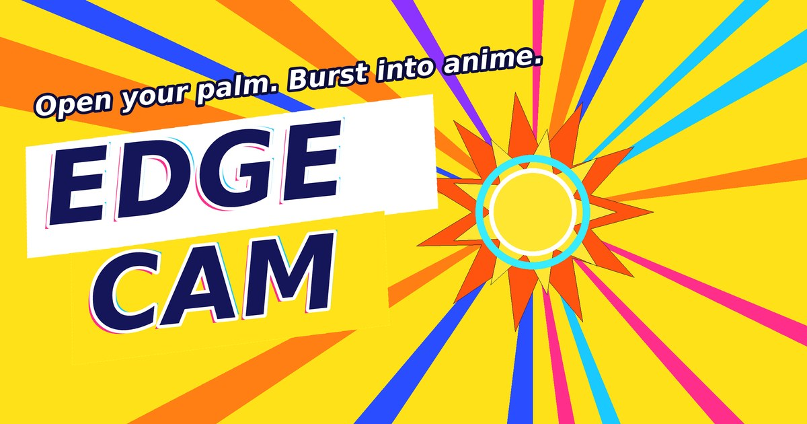

# Edge Cam

**Open your palm and burst into an anime world, live, in your browser.**

Edge Cam is a real-time camera effect. It cuts you out of your room, turns you into a comic-style character with a flame outline, and swaps your background for an animated pop-art world. Everything is controlled with hand gestures. There's no app to install, and nothing leaves your device.

**▶ Try it: [mudit2308.github.io/edge-cam](https://mudit2308.github.io/edge-cam/)**



---

## Gestures

| Gesture | What it does |
|---|---|
| ✋ Open palm | Charges up while you hold it. Let go to blast into the anime world. A longer hold makes a bigger blast. |
| ✊ Fist | Pulls the effect back into your hand |
| ✌️ Peace sign | Switches to the next theme |
| ☝️ Point | Fires a laser from your fingertip |
| 🙌 Two open hands | Spread them to grow the effect, bring them together to shrink it |
| 🙏 Palms together | Charges your ultimate. Push toward the camera to fire. |
| ↔️ Tilt your head | Switches theme |
| 📳 Shake your phone | Switches the look |
| 📢 Shout | Bursts the effect (optional) |

## Features

- **7 themes:** Anime, Neon night, Danger, Retro VHS, Manga, Golden Aura and Vaporwave
- **Burst transition:** the world explodes out of your palm with shockwaves, flying debris with physics, a glitch hit and a zoom punch
- **Face effects:** glowing anime eyes, a neon visor or anime blush that tracks your face
- **Comic stickers** (BOOM!, ZAP!, KA-BOOM!!) on every gesture
- **Depth:** cubes orbit around you, passing behind and in front of your body
- **Your own background:** use any photo, GIF or short video as the world behind you
- **Duet mode:** two people on camera get different outline colours
- **Sound:** synthesized whooshes, impacts and zaps. Load a song and the scene pulses to the beat and bursts on the drop.
- **Recording:** 3-2-1 countdown, auto-stop after 15, 30 or 60 seconds, a watermark, and sound mixed in. Save straight to your gallery on phones.
- **Share look:** a link that opens Edge Cam with your theme, title and face effect already set
- **Installable:** add it to your home screen and it opens fullscreen like an app

## How it works

All processing happens on your device, every frame:

1. **Body segmentation:** the [MediaPipe](https://developers.google.com/mediapipe) selfie segmenter finds you in the camera frame. The mask is smoothed over time, and tracked hands are painted into it so fingers don't disappear.
2. **Hand and face tracking:** the MediaPipe hand landmarker (21 points per hand, up to 2 hands) and face detector drive the gestures, face effects, head tilt and duet mode. Gestures are recognised from finger-joint geometry.
3. **WebGL2 shaders:**
   - A two-pass Gaussian blur turns the hard mask into a smooth distance-like field. The flame outline, ink line and neon ring are iso-levels of that field, warped by flowing noise.
   - You're posterized into theme colours, with halftone dots, ink edges from a Sobel filter, and rim light.
   - The background (sunburst rays, halftone clouds, speed lines) is generated per pixel.
   - The burst is a noise-distorted radial field centred on your palm.
   - A post pass adds the glitch hit (RGB split, block shifts, shake) and the VHS tape look.
4. **Canvas 2D layers:** particles, cubes, the animated title, stickers and face effects are drawn on separate layers and blended in the shader.
5. **Web Audio:** every sound effect is synthesized in code. Beat detection watches bass energy for sudden jumps, and a drop is a sustained jump in loudness.
6. **MediaRecorder** captures the canvas and the audio mix into an MP4 or WebM file.

Phones get a lighter shader, a 30 fps cap, frame-split tracking and automatic quality scaling.

**Tech:** HTML, JavaScript (no framework, no build step), WebGL2 / GLSL, MediaPipe Tasks Vision, Web Audio API, MediaRecorder, PWA (manifest and service worker).

## Run it locally

Browsers only allow the camera on `https://` or `localhost`, so serve the folder rather than opening the file directly:

```bash
git clone https://github.com/mudit2308/edge-cam.git
cd edge-cam
python -m http.server 8000
# open http://localhost:8000
```

To try it on your phone, use the GitHub Pages link above. Phones need `https://`.

## Privacy

Your camera and microphone never leave your browser. The tracking models download once from Google's MediaPipe CDN, and all processing runs locally. Nothing is uploaded or stored on a server.

## Credits

- Inspired by TouchDesigner anime-style camera effects shared by creators online
- Body, hand and face tracking: [MediaPipe Tasks Vision](https://developers.google.com/mediapipe/solutions/vision)
- Fonts: Montserrat and JetBrains Mono via Google Fonts

## License

[MIT](LICENSE) © 2026 Mudit Pathak
